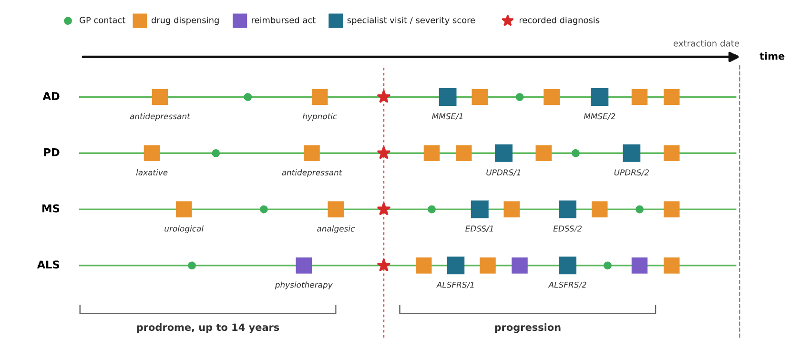

I am a Principal Investigator at the Paris Brain Institute (ICM), in the ARAMIS Lab, a joint INRIA–ICM team that develops data-science and AI methods for neurology. Within ARAMIS, I lead a group of six working on routinely collected health data, and I am a member of the Institute's Center for AI and Data Science for neurological disorders. 

I came to epidemiology from machine learning. After an engineering degree from École Polytechnique, specialising in applied mathematics, and an M.Sc. in Machine Learning from University College London, I completed a PhD in Applied Mathematics at ENS Paris-Saclay under the supervision of Vianney Perchet and Noureddine El Karoui. My thesis, prepared in parallel with a position at Criteo AI Lab, dealt with online learning and auction theory. I joined the ARAMIS Lab as a postdoctoral fellow in 2019, moved to the epidemiology of neurodegenerative diseases, and obtained the Habilitation à Diriger des Recherches from Sorbonne University in 2026.

In 2026, I was selected as one of France's ten Next Gen Leaders in Health (La French Care and Le Figaro, academic category), and our work on the rising prevalence of motor neurodegenerative diseases was selected among the five most exciting studies at the European Academy of Neurology Congress in Geneva.

Research
======

A neurodegenerative disease is diagnosed at the end of a process that has run for years, and every current treatment starts at that end. Routinely collected health data, the claims and hospital records generated as a by-product of ordinary care for an entire population, give access to these years before diagnosis. They capture, at national scale and without recruitment, the medications, diagnoses and care of people long before any diagnosis, including those who will never be diagnosed. My research uses these data (national claims databases, hospital data warehouses and population registers) to study neurological disorders from their earliest signs to their progression.

<figure class="research-figure">
  
  <figcaption>Care trajectories recorded in routine health data, before and after diagnosis.</figcaption>
</figure>

Our work is organised around four axes.

**Phenotyping from clinical notes.** AI now makes it possible to exploit a part of routine-care data that has long remained out of reach: the free text written by clinicians, from neurologists' notes to hospital reports and letters. These texts record what administrative data do not, such as the confirmed diagnosis, the date of onset and disease severity. With NeuroCohortBuilder, a pipeline built on open-weight language models run inside the hospital environment, we extract this information from the notes of the AP-HP clinical data warehouse and link it to the national claims database to measure what national data can and cannot show.

**Validating national health databases and comparing countries.** A disease must be identified and dated consistently before it can be compared across health systems. We develop harmonised case definitions and use them to estimate incidence and its trends in France and across Europe, so that differences between countries reflect populations rather than data sources. Recent work includes national incidence estimates for multiple sclerosis and motor neuron diseases in France, and a France–Sweden analysis of what drives their rising prevalence. This axis relies on collaborations with Karolinska Institutet, Aarhus University, the Zi in Berlin and University College London.

**Transnosographic study of the prodrome of neurological disorders.** Neurodegenerative diseases begin years before diagnosis. Rather than testing one hypothesis at a time, we use agnostic, data-driven approaches to scan the care trajectories of hundreds of thousands of patients, in nested case-control designs replicated across national databases. This allows us to characterise the years preceding Alzheimer’s disease, Parkinson’s disease, multiple sclerosis and ALS, and we then use Mendelian randomisation to separate early symptoms from causal risk factors.

**Data-driven subtyping.** We combine care trajectories, clinical information, environmental exposures and genetics to identify subgroups of patients that may cut across diagnostic categories and differ in their course. The long-term aim is to stratify patients at diagnosis and to identify, for each subgroup, existing interventions that may alter it.

Funding
======

My work is funded by the PEPR ProdroMND (France 2030, Principal Investigator) and the PEPR Transcend (France 2030, co-investigator). It was previously funded by the EU Joint Programme – Neurodegenerative Disease Research (JPND), in collaboration with Karolinska Institutet and the University of Queensland.

Open software
======

**NeuroCohortBuilder.** A phenotyping pipeline developed in our group that extracts from clinical notes what administrative records do not contain: the confirmed diagnosis, the onset date reported by the neurologist and the severity at baseline. It runs open-weight language models inside the hospital environment and attaches a certainty level to each extracted item, so that experts only review the cases the model is unsure about. In ALS, it reached 97% sensitivity and 97% positive predictive value against expert review, and agreed with the Pitié-Salpêtrière expert ALS cohort in 93% of cases.

**[sndsTools](https://github.com/SNDStoolers/sndsTools).** A community R package, developed with other SNDS users, to extract healthcare use for a given population from the French national health data system: outpatient care and drug dispensing, long-term illness status and hospital stays, following the national health insurance recommendations and standard quality filters.

Collaborations
======

Our comparative work relies on long-standing collaborations with groups working on national health data in other countries:

* **Sweden**, Karolinska Institutet: Pr. Fang Fang, Pr. Kyla McKay
* **Denmark**, Aarhus University: Pr. Mette Nørgaard, Pr. Henrik Toft Sørensen
* **Germany**, Central Research Institute of Ambulatory Health Care (Zi), Berlin: Pr. Jakob Holstiege
* **United Kingdom**, University College London: Pr. Anette Schrag, Pr. Mika Kivimäki
* **Australia**, University of Queensland (JPND consortium), Dr. Baptiste Couvy-Duchesne, Dr. Alan McRae

In France, we work closely with the neurology departments of Pitié-Salpêtrière hospital and the Paris Brain Institute.

Team
======





<h3>Current membersFormer members</h3>




{{ parts[0] | slice: 0 }}{{ parts[1] | slice: 0 }}


{{ m.name }}


{{ m.role }}






